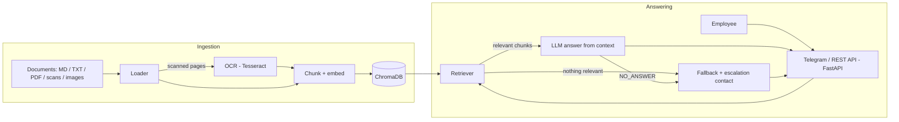

# Enterprise AI Help Desk

An AI-powered help desk for employees. Ask a question in plain English and get an answer drawn from your company documents: HR policies, onboarding, leave, payroll, IT procedures and other internal processes. It works over a **Telegram bot** and a **REST API**.

Built with a **RAG (Retrieval-Augmented Generation)** pipeline using **LangChain**, **ChromaDB** and the **OpenAI API**, with **OCR** so scanned PDFs and image-based documents are searchable too.

## Features

- **RAG pipeline**: documents are chunked, embedded into ChromaDB, and the most relevant chunks are retrieved to generate context-aware answers with sources
- **OCR document processing**: scanned PDFs and images (PNG/JPG/TIFF) are read with Tesseract, so both structured and unstructured documents go into the knowledge base
- **Fallback & escalation workflow**: if nothing relevant is found (or the model cannot answer from the context), the bot says so and gives the right support contact (HR, Payroll or IT) instead of guessing
- **Grounded answers**: the model is told to answer only from retrieved context, and answers list their source documents
- **Two interfaces**: Telegram bot (webhook) and a `/ask` HTTP endpoint
- **Sample query suite** to check answers and the fallback behaviour

## Architecture



## Tech Stack

Python, GenAI (OpenAI LLM + embeddings), LangChain, RAG, ChromaDB, OCR (Tesseract, PyMuPDF), FastAPI, Telegram Bot API

## Project Structure

```
enterprise-ai-help-desk/
├── app/
│   ├── main.py              # FastAPI: /ask, /webhook (Telegram), /health
│   ├── config.py
│   ├── telegram_client.py
│   └── rag/
│       ├── loader.py        # loads md/txt/pdf/images as documents
│       ├── ocr.py           # OCR for scanned PDFs and images
│       ├── vectorstore.py   # chunking + ChromaDB index
│       └── chain.py         # retrieval, answer generation, fallback/escalation
├── data/
│   ├── docs/                # knowledge base (sample documents included)
│   └── escalation_contacts.json
├── scripts/
│   ├── ingest.py            # build the index
│   └── cli_chat.py          # chat in the terminal
├── tests/
│   ├── queries.json
│   └── run_eval.py
├── requirements.txt
└── .env.example
```

## Setup

**1. Clone and install**
```bash
git clone https://github.com/SSrivarshini/enterprise-ai-help-desk.git
cd enterprise-ai-help-desk
python -m venv venv && source venv/bin/activate   # Windows: venv\Scripts\activate
pip install -r requirements.txt
```

**2. Install Tesseract** (only needed for scanned PDFs and images)
- Windows: install from https://github.com/UB-Mannheim/tesseract/wiki and set `TESSERACT_CMD` in `.env`
- macOS: `brew install tesseract`
- Linux: `sudo apt install tesseract-ocr`

**3. Environment**
```bash
cp .env.example .env    # add your OPENAI_API_KEY
```

**4. Add your documents**

Put `.md`, `.txt`, `.pdf` (digital or scanned) or image files in `data/docs/`. The folder ships with a few sample documents for a fictional company. Edit `data/escalation_contacts.json` with your real support contacts.

**5. Build the index**
```bash
python -m scripts.ingest
```

**6. Try it in the terminal**
```bash
python -m scripts.cli_chat
```

**7. Run the API / Telegram bot**
```bash
uvicorn app.main:app --port 8000
```
Test the API:
```bash
curl -X POST http://localhost:8000/ask -H "Content-Type: application/json" \
     -d '{"question": "How many days of annual leave do I get?"}'
```
For Telegram, create a bot with [@BotFather](https://t.me/BotFather), put the token in `.env`, expose your server (for example `ngrok http 8000`) and set the webhook:
```bash
curl "https://api.telegram.org/bot<TOKEN>/setWebhook?url=<PUBLIC_URL>/webhook&secret_token=<TELEGRAM_WEBHOOK_SECRET>"
```

## Example

```
You: How many days of annual leave do I get?
Bot: You get 18 days of annual leave per calendar year, credited on 1 January.
     Sources: hr_leave_policy.md

You: What is the stock option vesting schedule?
Bot: I couldn't find this in the company knowledge base. Please contact HR Support at
     hr@acme-corp.example (Mon-Fri, 9:30 AM - 6:00 PM) and they will help you.
```

## How the fallback works

1. The question is matched against the knowledge base. If no chunk reaches `RELEVANCE_THRESHOLD`, the bot falls back right away.
2. Otherwise the LLM answers only from the retrieved context. If it cannot, it returns `NO_ANSWER` and the bot falls back.
3. The fallback detects the topic (HR, Payroll, IT, or general) from the question and returns the matching contact from `data/escalation_contacts.json`.

Tune `RELEVANCE_THRESHOLD` and `TOP_K` in `.env` for your documents.

## Testing

```bash
python -m tests.run_eval
```
Runs the queries in `tests/queries.json` against the sample documents. Each query must either contain an expected keyword or correctly trigger the fallback. Add more queries to the file to grow coverage.

## Future Improvements

- Conversation memory for follow-up questions
- Per-department access control on documents
- Hybrid (keyword + vector) search and re-ranking
- Admin upload endpoint and automatic re-indexing
- Docker deployment

## Author

**Srivarshini S**: [GitHub](https://github.com/SSrivarshini)

## License

MIT
